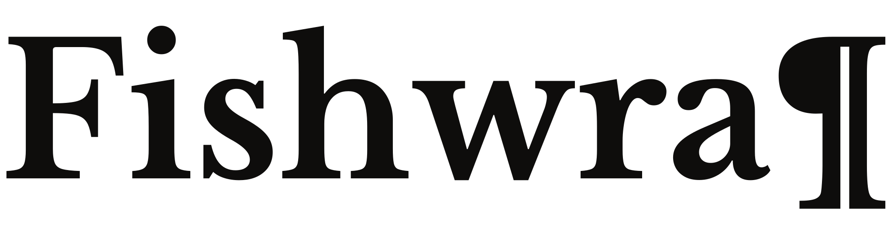

<div align="center">
  
  <br>
  <b>The algorithm you can read. The feed that ends.</b>
</div>

<br>

Fishwrap is the engine for the morning paper. RSS feeds, Reddit threads, and Hacker News go in. One edition of HTML comes out. Then it stops. Every editorial decision is recorded in an audit log the reader can open.

The engine is a signed OCI image at `ghcr.io/maxspevack/fishwrap`. A publication is a config file and a theme. [Daily Clamour](https://dailyclamour.com) is the worked example; everything else is yours.

**Four editions are live:**
*   [The Daily Clamour](https://dailyclamour.com). The flagship instance. One edition a day at 04:00 Pacific.
*   [The Zero Day](https://fishwrap.org/demo/cyber/). Cybersecurity briefing.
*   [The Hallucination](https://fishwrap.org/demo/ai/). AI research briefing.
*   [The ShowRunner](https://fishwrap.org/demo/showrunner/). Entertainment briefing.

---

## Quickstart

You need Docker or Podman.

```bash
git clone https://github.com/maxspevack/fishwrap.git
cd fishwrap
mkdir -p output
docker run --rm \
    -v $(pwd)/demo:/cfg \
    -v $(pwd)/output:/output \
    ghcr.io/maxspevack/fishwrap:2.0 \
    fishwrap-build --config /cfg/config.py
```

The rendered edition lands at `output/index.html`. Open it.

To run a different vertical, swap the config path:

```bash
docker run --rm -v $(pwd)/demo:/cfg -v $(pwd)/output:/output \
    ghcr.io/maxspevack/fishwrap:2.0 \
    fishwrap-build --config /cfg/cyber_config.py
```

The full consumer contract (every input, every output path, every CLI surface, the versioning policy, the pinning recommendation) is in [`docs/IMAGE_CONTRACT.md`](docs/IMAGE_CONTRACT.md).

---

## The Glass Box

The Glass Box is what we call the working surfaces. Every editorial decision is named, scored, and logged. The reader can open the log.

*   **The Fetcher** scours your defined feeds (RSS, JSON, Reddit) using concurrent I/O. Failed feeds are logged, not hidden.
*   **The Editor** classifies each article into a section using your `KEYWORDS` table and applies your `EDITORIAL_POLICIES` (boosts and penalties) to compute an Impact Score. Every score is recorded; every policy that fired is named.
*   **The Auditor** runs after every edition and emits a Transparency Report (`transparency_fragment.html`) showing how much noise was filtered, which sources won, which articles barely made it, and which barely missed.
*   **The Enhancer** scrapes full text where possible so consumers don't click out. Rate-limited.
*   **The Printer** renders the final HTML against a Jinja2 theme of your choosing.

Behind the scenes is a SQLite "Newsroom" database that stores the article corpus during a run. In containerized contexts the database is ephemeral; every run starts fresh.

---

## Run your own

Fishwrap is the engine. A publication is the config and the theme. Fork [Daily Clamour](https://github.com/maxspevack/dailyclamour.com), replace the config and the theme, and you have your own paper.

The two contracts that govern a fork:

1. [`docs/IMAGE_CONTRACT.md`](docs/IMAGE_CONTRACT.md). What the image expects and produces.
2. [`docs/CONFIG_SCHEMA.md`](docs/CONFIG_SCHEMA.md). Every key the engine recognizes.

---

## Repository structure

*   `fishwrap/`. The stateless engine.
*   `demo/`. Four reference configurations and themes (`vanilla`, `cyber`, `ai`, `showrunner`).
*   `docs/`. The source for [fishwrap.org](https://fishwrap.org), plus the consumer contract, ADRs, schema reference, and release notes.
*   `Dockerfile`. The release artifact recipe.
*   `.github/workflows/`. Release and demo refresh workflows.

---

## Documentation

| | |
|---|---|
| [Brand Bible](docs/BRAND.md) | The voice and visual standard the rest of the corpus answers to |
| [Image Contract](docs/IMAGE_CONTRACT.md) | Public contract for image consumers |
| [Config Schema](docs/CONFIG_SCHEMA.md) | Every key the engine recognizes |
| [Release Notes](docs/RELEASE_NOTES.md) | Version history |
| [Releasing](docs/RELEASING.md) | Runbook for cutting new versions |
| [Contributing](CONTRIBUTING.md) | How to contribute to the engine itself |
| [Architecture Decisions](docs/adr/) | ADRs for significant decisions |
| [Versioning Policy](docs/VERSIONING.md) | What patch / minor / major mean |

---

## Roadmap

The roadmap lives in GitHub. There is no separate roadmap document.

| | |
|---|---|
| [Issues](https://github.com/maxspevack/fishwrap/issues) | Everything open, in progress, and recently closed |
| [Milestones](https://github.com/maxspevack/fishwrap/milestones) | Versioned groupings of issues currently being worked on |

---

## License

Apache License 2.0.
