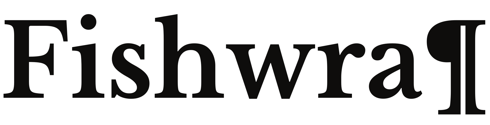

<div align="center">
  
  <br>
  <b>The algorithm you can read. The feed that ends.</b>
</div>

<br>

Fishwrap is the engine for the morning paper. RSS and Atom feeds go in. One edition of HTML comes out. Then it stops. Every editorial decision is recorded in an audit log the reader can open.

The engine is a signed OCI image at `ghcr.io/maxspevack/fishwrap`. A publication is a config file and a theme. [Daily Clamour](https://dailyclamour.com) is the worked example; everything else is yours.

**One edition is live. One reference demo runs alongside it:**
*   [The Daily Clamour](https://dailyclamour.com). The flagship instance. One edition a day at 04:00 Pacific.
*   [The Vanilla](https://fishwrap.org/demo/vanilla/). The reference demo, rebuilt every day from the `main` branch. This is the engine's integration environment, not a release.

---

## Quickstart

You need `git`, `make`, and Python 3.12 or newer with the `venv` module (on Debian and Ubuntu, the `python3-venv` package).

```bash
git clone https://github.com/maxspevack/fishwrap.git
cd fishwrap
make setup
make run-vanilla
```

`make run-vanilla` fetches the demo's feeds and builds one edition in under two minutes. Open `demo/output/index.html`. It redirects to the newest edition, `demo/output/<YYYY-MM-DD>/index.html`, dated in Pacific time.

These commands run the engine from the `main` branch, the same code that builds The Vanilla. The released image, `ghcr.io/maxspevack/fishwrap:2.0`, contains the older 2.0 engine. That engine reads `demo/config.py`, which exists at the `v2.0.2` tag and not on `main`. The image's instructions are in the README at that tag.

---

## The Glass Box

The Glass Box is what we call the working surfaces. Every editorial decision is named and logged. The reader can open the log.

*   **The Fetcher** scours your defined feeds (RSS and Atom) using concurrent I/O. Failed feeds are logged, not hidden.
*   **The Editor** classifies each article into a section (by source-default or keyword fallback), folds duplicates into the newest copy and counts how many sources carried the story, applies the diversity cap per source per section, truncates to the section's edition size, and assigns each item a tier (lead / feature / standard). The signed policies in your masthead can drop articles (source/title/topic bans), bypass diversity caps (whitelist), or promote stories to the lead tier (section_lead_preference) — every policy that fires is named on the story. It writes **the runsheet**: one record per candidate (where it came from, how it competed, where it landed) plus a header naming the engine commit, the window, and the fingerprints of your three editorial files. Nothing downstream recomputes a decision.
*   **The Printer** renders from the runsheet alone: the paper with a per-story audit drawer, the runsheet as a readable page (what came in, what was cut and why, what led and why, every feed's yield), a read-only feeds page, and The Morgue (every prior version of your masthead, dossier, and policies).
*   **Replay** re-runs any archived runsheet's candidates under your masthead as it is now and prints what moved. Change a dial, replay yesterday, read the consequence. `make replay DATE=YYYY-MM-DD`.
*   **The Publisher's loop** runs in a terminal: `make show` prints the edition as text, `make policy ARGS='ban-source example.com --because "..."'` files a policy in your words, `make replay` shows what it would have done to any edition, and the next build applies it. No server, no write path but your own files.

The user-facing config is three files: `masthead.toml` (the structured data: sections, feeds, source-section routing), `policies.jsonl` (your signed policies, one sentence each, append-only), and `dossier.md` (the editor's voice in prose).

Behind the scenes is a SQLite "Newsroom" database that stores the article corpus during a run. The database is ephemeral; every run starts fresh. The durable record is the runsheet.

---

## Run your own

Fishwrap is the engine. A publication is the config and the theme. Fork [Daily Clamour](https://github.com/maxspevack/dailyclamour.com), replace the config and the theme, and you have your own paper.

The two contracts that govern a fork:

1. [`docs/IMAGE_CONTRACT.md`](docs/IMAGE_CONTRACT.md). What the image expects and produces.
2. [`docs/CONFIG_SCHEMA.md`](docs/CONFIG_SCHEMA.md). Every key the engine recognizes.

---

## Repository structure

*   `fishwrap/`. The stateless engine.
*   `demo/`. The Vanilla's editorial files (`masthead.toml`, `dossier.md`, `policies.jsonl`) and the `basic` theme.
*   `docs/`. The source for [fishwrap.org](https://fishwrap.org), plus the consumer contract, ADRs, schema reference, and release notes.
*   `Dockerfile`. The release artifact recipe.
*   `.github/workflows/`. Release and demo refresh workflows.

---

## Documentation

| | |
|---|---|
| [Brand Bible](docs/BRAND.md) | The voice and visual standard the rest of the corpus answers to |
| [Image Contract](docs/IMAGE_CONTRACT.md) | Public contract for image consumers |
| [Config Schema](docs/CONFIG_SCHEMA.md) | Every key the engine recognizes |
| [Release Notes](docs/RELEASE_NOTES.md) | Version history |
| [Releasing](docs/RELEASING.md) | Runbook for cutting new versions |
| [Architecture Decisions](docs/adr/) | ADRs for significant decisions |
| [Versioning Policy](docs/VERSIONING.md) | What patch / minor / major mean |

---

## Roadmap

The roadmap lives in GitHub. There is no separate roadmap document.

| | |
|---|---|
| [Issues](https://github.com/maxspevack/fishwrap/issues) | Everything open, in progress, and recently closed |
| [Milestones](https://github.com/maxspevack/fishwrap/milestones) | Versioned groupings of issues currently being worked on |

---

## License

Apache License 2.0.
