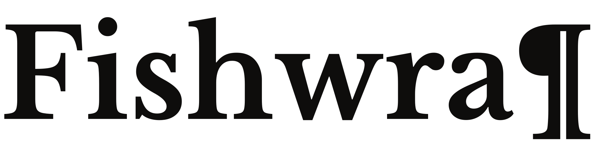

  
   
  <h3><em>The peasants scroll. The elite read.</em></h3>

---

## Mission and Vision

Fishwrap is for the readers who have already left.

The feed is not a medium; it is a posture, and the posture is over. The reader who arrives at this page has spent enough mornings staring at a thumb-shaped rectangle that scrolls without floor, and they are tired in a way no app has a remedy for. We do not propose moderation. We propose departure.

Our mission is to print the morning paper for the reader who has unplugged the wall. One edition a day. Eleven pages. A back page that says *the end*. The reader sets the policy in plain language; the engine sets the type. There is no recommendation surface. There is no inferred preference. There is no notification.

Our vision is a web in which the people who read are no longer confused with the people who scroll. Fishwrap is the receipt for the exit, and the exit is real.

We do not measure your time on this page. We are not paid to. When the edition ends, go outside.

---

## The Anxiety of the Thumbs Down

Every news aggregator has a thumbs-down button. Every news aggregator has a black box behind the button. The reader presses the thumbs-down on a celebrity divorce story and does not know whether they have just suppressed the celebrity, the divorce, the publication that ran the piece, the political coverage of the same celebrity in next week's edition, or the entire section the story sat under. The cost of feedback is opaque. The cost of opacity is silence. The reader stops pressing the button. The feed gets worse. The reader scrolls anyway.

The political-golf trap is the moat in plain speech. A reader who downvotes a Donald Trump golf story does not want to lose policy coverage of the Donald Trump administration. The algorithm does not distinguish between the two; the reader cannot ask it to. The thumbs-down is the half-gesture of a reader who has not been permitted to write a margin note. So the reader does not press the button. So the algorithm does not learn. So the feed circles back to the same celebrity and the same divorce and the same opaque consequence. This is not a UX problem. This is a category problem. Every aggregator on the open web operates this way because exposing the policy would expose the absence of one.

Fishwrap exposes the policy.

The Editor's Note replaces the thumbs-down because that is what editors write. *Penalty: Golf, −20.* *Boost: Executive Order, +20.* The note is a sentence, not a vote. The sentence is yours. It is named, dated, signed, and persisted; it stays in effect across editions until you strike it; and every story that fires it shows you which sentence fired and by how much. Mark it up. The edition obeys.

There is no recommendation surface because there is no anonymous editor. There is no inferred preference because every preference is a sentence the reader wrote. The thumbs-down is not redesigned; it is fired. The chair is yours.

---

## Three reader-stakes

Three things the reader does, what stays in effect, and what the engine commits to. Concrete, verifiable inside the engine, not abstractions.

**The reader's daily act.** Open the proof. Read the edition. Write a margin note on any story that should have scored differently, or any pattern that should not have run, or any source that should run more often. The note is a sentence in plain English. The system files it as a policy and reports the file path. The act is the work.

**What stays in effect.** Every note the reader has written, with the date and the edition it was written against, named on a single audit page the reader can open at any time. Notes do not expire. Notes do not silently fall off when the engine updates. Notes are struck only when the reader strikes them; the strike is also a note, also dated, also filed. The policy file is the masthead.

**What the engine commits to.** Every story carries the score it received and the names of every policy that fired on it, in the order they fired, with the integer contribution of each. Every fired policy is the reader's, or it is named *default* and dated against the engine's last release. The engine never scores a story by a rule it cannot name. The audit log is the contract.

---

## Four editions are live. Read one.

- [**The Daily Clamour**](https://dailyclamour.com). The flagship instance. One edition a day at 04:00 Pacific.
- [**The Zero Day**](/demo/cyber/). Cybersecurity briefing.
- [**The Hallucination**](/demo/ai/). AI research briefing.
- [**The ShowRunner**](/demo/showrunner/). Entertainment briefing.

Source: [github.com/maxspevack/fishwrap](https://github.com/maxspevack/fishwrap). The engine is the config file and the theme. Daily Clamour is the worked example; everything else is yours.

*You did not quit the feed to find a better feed. You quit the feed.*
