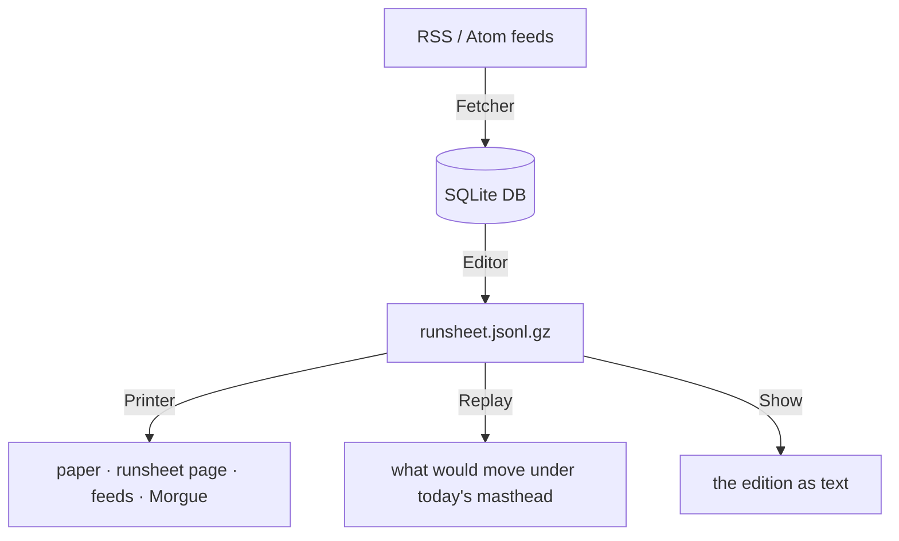

# Fishwrap Engine ⚙️

This directory contains the core source code for Fishwrap.

## The Glass Box Architecture 🏛️

Fishwrap is designed as a transparent, auditable pipeline. It doesn't just show you news; it tells you *why* it showed you news.

### 1. `fishwrap.fetcher` (The Ingestion)
*   **Parallel Execution:** Uses `ThreadPoolExecutor` to fetch dozens of feeds concurrently.
*   **Upserts by link:** New data merges into the existing row; full text and the enhanced flag are never overwritten.
*   **Rate Limiting:** Token-bucket rate limiting per host for polite scraping.
*   **No pre-computation:** The fetcher just persists the article. Classification and policy application happen at edition build time in the editor. RSS and Atom only; vote-ranked sources and their plumbing were removed on 2026-11-01.

### 2. `fishwrap.masthead` (The Config Loader)
*   **Two-file user data:** `masthead.toml` (structured config) + `dossier.md` (the editor's voice in prose) + `policies.jsonl` (the append-only signed-policy log).
*   **Validation:** Required keys are checked at load time; bad input fails with a named error rather than silent fallback.

### 3. `fishwrap.editor` (The Pipeline)
*   **Six steps, no scoring:** intake → exclude (signed policies) → classify → dedup → diversify → truncate → tier. Candidates are processed in a total order (newest first, ties by link), so two builds of the same data are the same edition.
*   **The editor's view of a story** is its title and the first 2,000 characters of body. Keywords and topic bans see nothing deeper. That view is what the runsheet stores.
*   **Classification:** Maps articles to sections via source-default first, keyword fallback second.
*   **Dedup:** Global fuzzy dedup with time-windowed blocking + Jaccard pre-filter + SequenceMatcher ratio; the threshold is `engine.dedup_similarity_threshold` in the masthead. The newest copy leads the cluster and records its members and how many distinct sources carried the story (its coverage).
*   **Diversity cap:** Per section, no more than `max_per_source` items from any single source — unless the source is whitelisted.
*   **Tier:** Top `lead_count` are leads; next `feature_count` are features; the rest are standard. The `section_lead_preference` policy can promote items matching its keywords into the lead slots.
*   **Output: the runsheet** (`fishwrap.runsheet`), `demo/output/<date>/runsheet.jsonl.gz`. Line 1 is the header (edition date, engine commit, window, config fingerprints, dedup settings, per-feed yield, the funnel); each following line is one candidate with its section, cluster, the policies that fired, its signals, and its fate.

### 4. `fishwrap.scoring` (Policy Evaluation)
*   **No numeric score:** Articles are seeded within a section by recency, not by a magic number.
*   **Five policy primitives** (from `policies.jsonl`): `source_ban`, `title_pattern_ban`, `topic_ban`, `source_whitelist`, `section_lead_preference`. Each is a signed, named policy.

### 5. `fishwrap.printer` (The Face)
*   **From the runsheet alone.** Recomputes nothing. Renders into `demo/output/<YYYY-MM-DD>/`: `index.html` (the paper), `runsheet.html` (the edition as a document), `feeds.html` (read-only), `morgue.html` plus `morgue-view-<sha>.html` per prior version; then `demo/output/index.html`, the pointer to the newest edition, written last.
*   **The audit drawer** on each story tells the step-by-step story of how it got where it got, plus its coverage: how many sources carried it and which copies were folded in.

### 6. `fishwrap.replay`
*   `python -m fishwrap.replay <runsheet>` re-runs the editor on that edition's candidates under the current masthead and prints what entered, left, changed section, or moved. `--expect-zero` exits 1 on any change; the demo workflow runs it on every build as the determinism gate.

### 7. `fishwrap.show` and `fishwrap.policy` (The Publisher's loop)
*   `python -m fishwrap.show [runsheet] [--cuts N]` prints the edition as text: every printed story with seed, tier, coverage, source and age; the cap and capacity cuts per section; the feeds that delivered nothing.
*   `python -m fishwrap.policy <verb> ... --because "<sentence>"` appends a signed policy to `policies.jsonl`: `ban-source`, `ban-title`, `ban-topic`, `print-all` (optionally `--except <regex>`), `prefer-lead <section> <keywords...>`, `strike <policy_id>`, `list`. The sentence is required; it is what the drawer and the runsheet page show.

The scraper (`fishwrap.enhancer`, newspaper3k) was deleted on 2026-11-05: nothing rendered its text, it crashed natively under its thread pool, and its lxml dependency had no wheel for the laptop's Python. The whole dependency set is now SQLAlchemy, defusedxml, tqdm.

## Configuration

The engine reads its configuration from an instance directory pointed at by the `FISHWRAP_CONFIG` environment variable. An instance directory contains:

*   `masthead.toml`: required. Identity, engine settings, sections, feeds, source-section routing.
*   `dossier.md`: optional. The editor's voice in prose, consumed by the LLM editor in Editor mode.
*   `policies.jsonl`: optional. Append-only signed-policy event log.

See `demo/` for a worked example.
