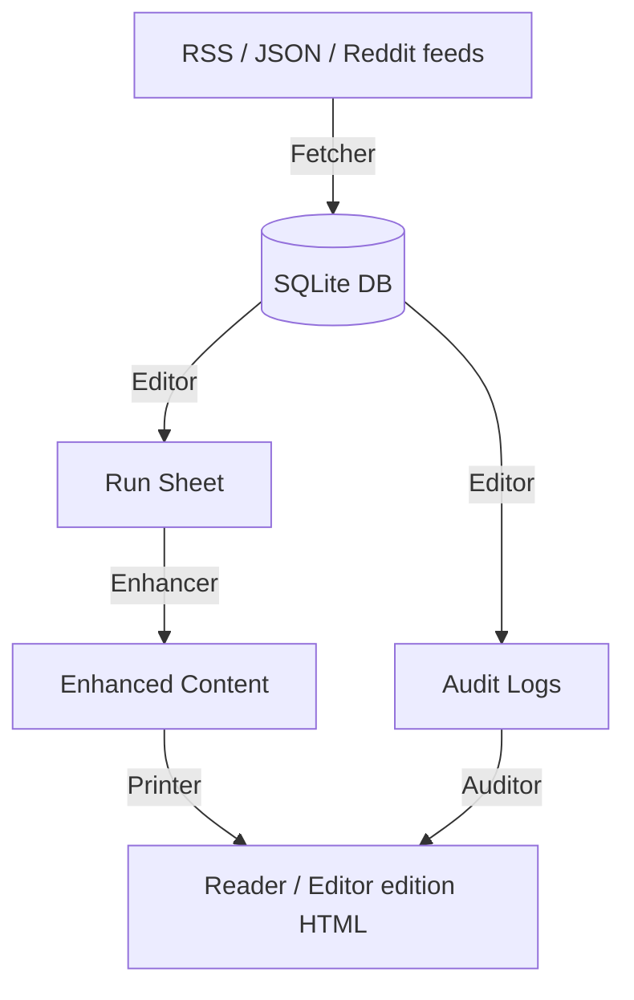

# Fishwrap Engine ⚙️

This directory contains the core source code for Fishwrap.

## The Glass Box Architecture 🏛️

Fishwrap is designed as a transparent, auditable pipeline. It doesn't just show you news; it tells you *why* it showed you news.

### 1. `fishwrap.fetcher` (The Ingestion)
*   **Parallel Execution:** Uses `ThreadPoolExecutor` to fetch dozens of feeds concurrently.
*   **Smart Upserts:** Merges new data with existing records in `newsroom.db` (SQLite), preventing data loss and handling history.
*   **Rate Limiting:** Respects `robots.txt` and implements Token Bucket rate limiting for polite scraping.
*   **No pre-computation:** The fetcher just persists the article. Classification and policy application happen at edition build time in the editor.

### 2. `fishwrap.masthead` (The Config Loader)
*   **Two-file user data:** `masthead.toml` (structured config) + `dossier.md` (the editor's voice in prose) + `policies.jsonl` (the append-only signed-policy log).
*   **Validation:** Required keys are checked at load time; bad input fails with a named error rather than silent fallback.

### 3. `fishwrap.editor` (The Pipeline)
*   **Six steps, no scoring:** intake → exclude (signed policies) → classify → dedup → diversify → truncate → tier.
*   **Classification:** Maps articles to sections via source-default first, keyword fallback second.
*   **Dedup:** Global fuzzy dedup with time-windowed blocking + Jaccard pre-filter + SequenceMatcher ratio.
*   **Diversity cap:** Per section, no more than `max_per_source` items from any single source — unless the source is whitelisted.
*   **Tier:** Top `lead_count` are leads; next `feature_count` are features; the rest are standard. The `section_lead_preference` policy can promote items matching its keywords into the lead slots.

### 4. `fishwrap.scoring` (Policy Evaluation)
*   **No numeric score:** Articles are seeded within a section by recency, not by a magic number.
*   **Five policy primitives** (from `policies.jsonl`): `source_ban`, `title_pattern_ban`, `topic_ban`, `source_whitelist`, `section_lead_preference`. Each is a signed, named policy.

### 5. `fishwrap.auditor` (The Conscience)
*   **Per-article audit logs:** Every candidate's decision trail (selected vs. rejected, classification reason, tier assignment) persisted to the DB.
*   **Editor-mode rationales:** In production, a Sonnet batched call per section produces a one-sentence rationale per article, grounded in specific lines of `dossier.md`. (The demo ships pre-authored rationales for a known set of stories.)

### 6. `fishwrap.enhancer` (The Body)
*   **Content Extraction:** Uses `newspaper3k` to scrape full text and authors for selected articles.
*   **Parallel Processing:** Enhances the entire run sheet in parallel for speed.

### 7. `fishwrap.printer` (The Face)
*   **Inline HTML:** Renders four pages into `demo/output/<YYYY-MM-DD>/` — `index.html` (the paper), `edition-editor.html`, `feeds-admin.html`, `morgue.html` — plus per-commit `morgue-view-<sha>.html` and `morgue-restore-<sha>.html` for each prior version of the masthead, and `demo/output/index.html`, a redirect to the newest edition written last.
*   **The Reader/Editor toggle** lives on the masthead: editor's name appears in Quantic green when signed in, "No editor on duty" in gray when signed out.
*   **The audit drawer** on each story tells the step-by-step story of how that article got where it got — no jargon, no abbreviations, just plain language with numbered steps.

## Configuration

The engine reads its configuration from an instance directory pointed at by the `FISHWRAP_CONFIG` environment variable. An instance directory contains:

*   `masthead.toml`: required. Identity, engine settings, sections, feeds, source-section routing.
*   `dossier.md`: optional. The editor's voice in prose, consumed by the LLM editor in Editor mode.
*   `policies.jsonl`: optional. Append-only signed-policy event log.

See `demo/` for a worked example.
